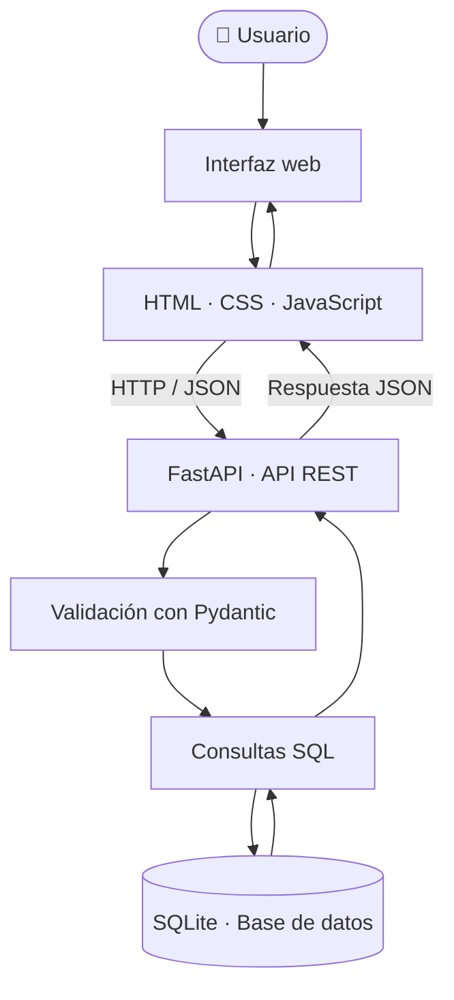
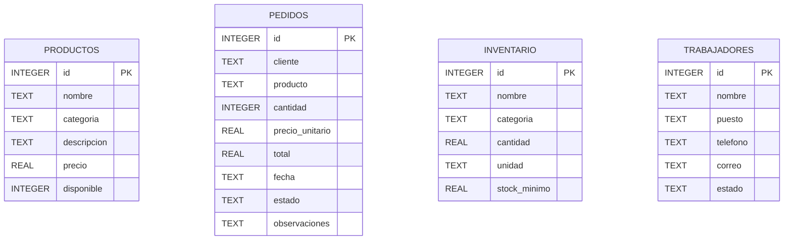

# ☕ ÉTER CAFÉ
### Sistema web de administración de cafetería | FastAPI · SQLite · Python

<p align="center">
  <strong>Administración inteligente · Organización · Tecnología</strong>
</p>

<p align="center">
  
  
  
  
  
</p>

---

## 1. Descripción del proyecto

**ÉTER Café** es una aplicación web desarrollada para administrar y organizar las operaciones principales de una cafetería.

El sistema permite gestionar pedidos, productos, inventario y trabajadores mediante una interfaz gráfica conectada a una API REST. Su desarrollo integra herramientas de backend, frontend y almacenamiento de datos para ofrecer una solución funcional y organizada.

La aplicación utiliza **FastAPI** para procesar las solicitudes, **SQLite** para almacenar la información y tecnologías web para construir una interfaz intuitiva.

## 2. Objetivos

### Objetivo general

Desarrollar un sistema web de administración para una cafetería mediante la implementación de una API REST, operaciones CRUD y una base de datos SQLite que permita gestionar la información de sus principales áreas operativas.

### Objetivos específicos

- Implementar operaciones CRUD para pedidos, productos, inventario y trabajadores.
- Desarrollar endpoints mediante FastAPI.
- Diseñar una base de datos para almacenar la información.
- Validar los datos recibidos mediante Pydantic.
- Crear una interfaz web conectada con el backend.
- Facilitar la consulta, registro, actualización y eliminación de información.

---

## 3. Funcionalidades principales

| Módulo | Descripción |
|:---|:---|
| **Dashboard** | Visualización de indicadores generales y actividad del sistema. |
| **Productos** | Administración de bebidas, productos, categorías, precios y disponibilidad. |
| **Pedidos** | Registro, consulta, modificación y eliminación de pedidos. |
| **Inventario** | Control de insumos, cantidades y niveles mínimos de existencias. |
| **Trabajadores** | Administración de información básica del personal. |

### Características del sistema

- Cálculo automático del total de los pedidos.
- Validación de información desde el backend.
- Identificación visual de existencias bajas.
- Almacenamiento persistente de datos.
- Comunicación entre frontend y backend mediante solicitudes HTTP.
- Interfaz adaptable a diferentes tamaños de pantalla.

---

##  4. Tecnologías utilizadas

| Tecnología | Función dentro del proyecto |
|:---|:---|
| 🐍 Python | Lenguaje principal del backend. |
| ⚡ FastAPI | Desarrollo de la API REST. |
| 🚀 Uvicorn | Servidor ASGI para ejecutar la aplicación. |
| 🗄️ SQLite | Almacenamiento de información. |
| 🔗 sqlite3 | Conexión y ejecución de consultas SQL. |
| ✅ Pydantic | Validación y estructuración de datos. |
| 🎨 HTML5 | Estructura de la interfaz. |
| 🖌️ CSS3 | Diseño y estilos visuales. |
| ⚙️ JavaScript | Interactividad y consumo de endpoints. |
| 📄 Jinja2 | Renderizado de plantillas HTML. |

---

##  5. Arquitectura del sistema

El proyecto utiliza una arquitectura cliente-servidor. La interfaz web se comunica con el backend mediante solicitudes HTTP. FastAPI procesa las solicitudes, valida los datos y ejecuta las operaciones correspondientes en SQLite.



###  Flujo de funcionamiento

1. El usuario interactúa con la interfaz.
2. JavaScript envía una solicitud al endpoint correspondiente.
3. FastAPI recibe y procesa la solicitud.
4. Pydantic valida los datos recibidos.
5. Se ejecuta la operación correspondiente en SQLite.
6. La API devuelve una respuesta.
7. La interfaz actualiza la información presentada.

---

##  6. Estructura del proyecto

```text
ETER_Cafe_FastAPI/
│
├── 📄 main.py
├── 📄 requirements.txt
├── 📄 README.md
├── 📄 .gitignore
│
├── 📂 templates/
│   └── 📄 index.html
│
└── 📂 static/
    ├── 📄 styles.css
    └── 📄 app.js
```

| Archivo | Descripción |
|:---|:---|
| `main.py` | Configuración de FastAPI, base de datos, modelos y endpoints. |
| `requirements.txt` | Dependencias necesarias para ejecutar el proyecto. |
| `README.md` | Documentación general. |
| `.gitignore` | Archivos excluidos del control de versiones. |
| `templates/index.html` | Plantilla principal de la interfaz. |
| `static/styles.css` | Estilos visuales. |
| `static/app.js` | Funciones e interactividad del frontend. |


---

## 7. Diseño de la base de datos

La aplicación utiliza **SQLite** como sistema de almacenamiento local. La base de datos `eter_cafe.db` contiene cuatro tablas principales:

| Tabla | Propósito |
|:---|:---|
| `productos` | Almacena los productos disponibles en el menú. |
| `pedidos` | Registra los pedidos realizados. |
| `inventario` | Controla los insumos y existencias. |
| `trabajadores` | Almacena información del personal. |

### 7.1. Diagrama entidad-relación



### 7.2. Descripción de las tablas

<details>
<summary>☕ <strong>Tabla: productos</strong></summary>

| Campo | Tipo | Descripción |
|:---|:---|:---|
| id | INTEGER | Identificador único. |
| nombre | TEXT | Nombre del producto. |
| categoria | TEXT | Categoría del menú. |
| descripcion | TEXT | Descripción del producto. |
| precio | REAL | Precio de venta. |
| disponible | INTEGER | Disponibilidad del producto. |

</details>

<details>
<summary>🧾 <strong>Tabla: pedidos</strong></summary>

| Campo | Tipo | Descripción |
|:---|:---|:---|
| id | INTEGER | Identificador único. |
| cliente | TEXT | Nombre del cliente. |
| producto | TEXT | Producto solicitado. |
| cantidad | INTEGER | Cantidad solicitada. |
| precio_unitario | REAL | Precio por unidad. |
| total | REAL | Importe total del pedido. |
| fecha | TEXT | Fecha y hora de registro. |
| estado | TEXT | Estado del pedido. |
| observaciones | TEXT | Indicaciones adicionales. |

</details>

<details>
<summary>📦 <strong>Tabla: inventario</strong></summary>

| Campo | Tipo | Descripción |
|:---|:---|:---|
| id | INTEGER | Identificador único. |
| nombre | TEXT | Nombre del insumo. |
| categoria | TEXT | Clasificación del insumo. |
| cantidad | REAL | Cantidad disponible. |
| unidad | TEXT | Unidad de medida. |
| stock_minimo | REAL | Nivel mínimo de existencias. |

</details>

<details>
<summary>👥 <strong>Tabla: trabajadores</strong></summary>

| Campo | Tipo | Descripción |
|:---|:---|:---|
| id | INTEGER | Identificador único. |
| nombre | TEXT | Nombre del trabajador. |
| puesto | TEXT | Puesto o función. |
| telefono | TEXT | Número telefónico. |
| correo | TEXT | Correo electrónico. |
| estado | TEXT | Estado del trabajador. |

</details>


##  8. Operaciones CRUD

El sistema implementa las cuatro operaciones fundamentales para administrar registros:

| Operación | Método HTTP | Función |
|:---|:---:|:---|
| 🟢 CREATE | `POST` | Crear registros. |
| 🔵 READ | `GET` | Consultar registros. |
| 🟡 UPDATE | `PUT` | Actualizar registros. |
| 🔴 DELETE | `DELETE` | Eliminar registros. |

### 🌐 8.1. Endpoints de la API

<details>
<summary>☕ <strong>Productos</strong></summary>

| Operación | Método | Endpoint |
|:---|:---:|:---|
| Crear | POST | `/api/productos` |
| Consultar todos | GET | `/api/productos` |
| Consultar uno | GET | `/api/productos/{id}` |
| Actualizar | PUT | `/api/productos/{id}` |
| Eliminar | DELETE | `/api/productos/{id}` |

</details>

<details>
<summary>🧾 <strong>Pedidos</strong></summary>

| Operación | Método | Endpoint |
|:---|:---:|:---|
| Crear | POST | `/api/pedidos` |
| Consultar todos | GET | `/api/pedidos` |
| Consultar uno | GET | `/api/pedidos/{id}` |
| Actualizar | PUT | `/api/pedidos/{id}` |
| Eliminar | DELETE | `/api/pedidos/{id}` |

</details>

<details>
<summary>📦 <strong>Inventario</strong></summary>

| Operación | Método | Endpoint |
|:---|:---:|:---|
| Crear | POST | `/api/inventario` |
| Consultar todos | GET | `/api/inventario` |
| Consultar uno | GET | `/api/inventario/{id}` |
| Actualizar | PUT | `/api/inventario/{id}` |
| Eliminar | DELETE | `/api/inventario/{id}` |

</details>

<details>
<summary>👥 <strong>Trabajadores</strong></summary>

| Operación | Método | Endpoint |
|:---|:---:|:---|
| Crear | POST | `/api/trabajadores` |
| Consultar todos | GET | `/api/trabajadores` |
| Consultar uno | GET | `/api/trabajadores/{id}` |
| Actualizar | PUT | `/api/trabajadores/{id}` |
| Eliminar | DELETE | `/api/trabajadores/{id}` |

</details>


  <br><br>
  ☕ Desarrollado con tecnología y propósito.
</p>
